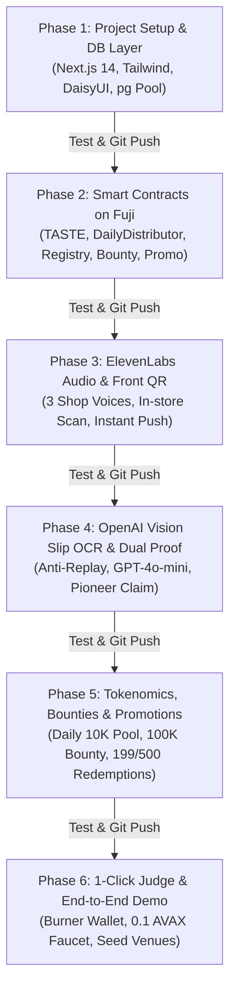

# TasteChain BKK — Implementation & Verification Plan (v3.0)

> **Repository:** [https://github.com/0xta/Uhackathon2026](https://github.com/0xta/Uhackathon2026)  
> **Target Network:** Avalanche C-Chain — Fuji Testnet (Chain ID: 43113)  
> **Database:** PostgreSQL 17 (`uhack-postgres:5432`, DB: `tastechain`)  
> **Changelog Tracker:** [`CHANGELOG.md`](./CHANGELOG.md)  
> **Product Requirements Document:** [`TastechainPRD.md`](./TastechainPRD.md)

---

## 1. Architecture & Phased Roadmap Overview



---

## 2. Standard Workflow for Every Phase

Every phase follows a strict 4-step execution protocol:
1. **Implementation:** Develop required components, routes, smart contracts, or backend services.
2. **Automated & Manual Verification:** Execute automated test scripts, run benchmark queries, and verify on-chain/database integrity.
3. **Changelog Documentation:** Record changes, additions, and test results into [`CHANGELOG.md`](./CHANGELOG.md).
4. **GitHub Synchronization:** Commit changes using Conventional Commits and push directly to `origin main` ([https://github.com/0xta/Uhackathon2026](https://github.com/0xta/Uhackathon2026)).

---

## 3. Detailed Phase Breakdown

### Phase 1: Project Scaffolding & Database Service Layer

#### Objectives
- Initialize Next.js 14+ App Router project with TypeScript, Tailwind CSS, and DaisyUI.
- Establish robust PostgreSQL connection pool connecting to `uhack-postgres:5432` (`tastechain`).
- Implement Data Access Layer for 36,369+ Bangkok F&B venues (`places` table).
- Build Search & Filter API (`/api/places`) with pagination, category badges, rating filters, and coordinate bounding boxes.

#### Deliverables
- `package.json`, `tsconfig.json`, `tailwind.config.ts`, `postcss.config.js`
- `src/lib/db.ts`: PostgreSQL connection pool with query timeout and error handling.
- `src/lib/services/places.ts`: Queries for Bangkok F&B places, pioneer slot status, and bounty flags.
- `src/app/api/places/route.ts`: API endpoint supporting `q`, `service_type`, `rating_min`, `has_bounty`, `limit`, and `offset`.
- `tests/phase1-places.test.ts`: Automated test suite for database queries and API response times.

#### Verification & Test Strategy
| Test Case | Description | Expected Result |
| :--- | :--- | :--- |
| **T1.1 DB Connection** | Test pg pool connection to `uhack-postgres` | Status 200, query returns `NOW()` |
| **T1.2 Place Count** | Verify Bangkok operational F&B count | Returns $\ge 36,000$ places |
| **T1.3 Search Latency** | Query `q=ผัดไท` with limit 20 | Latency $< 300\text{ms}$ |
| **T1.4 Filter Accuracy** | Filter `service_type=cafe` | 100% of returned items have type `cafe` |

#### Git & Changelog Action
```bash
git add .
git commit -m "feat(core): scaffold Next.js app, DaisyUI, and PostgreSQL places service"
git push origin main
```

---

### Phase 2: Smart Contracts on Avalanche Fuji

#### Objectives
- Setup Hardhat development environment with Solidity 0.8.24.
- Implement 5 core smart contracts:
  1. `TasteToken.sol`: ERC-20 utility token with authorized minters and burn mechanism.
  2. `TasteDailyDistributor.sol`: Epoch distribution vault for the daily 10,000 `$TASTE` pool.
  3. `TasteChainRegistry.sol`: Pioneer slot claims (1–3) and `bytes32` slip hash deduplication.
  4. `TasteChainBounty.sol`: Merchant escrow supporting AVAX and `$TASTE` rewards.
  5. `TastePromotionEscrow.sol`: Voucher redemption with 80% to merchant and 20% deflationary burn.
- Write full Hardhat unit tests with coverage $\ge 90\%$.
- Deploy contracts to Avalanche Fuji Testnet and record contract addresses.

#### Deliverables
- `contracts/TasteToken.sol`
- `contracts/TasteDailyDistributor.sol`
- `contracts/TasteChainRegistry.sol`
- `contracts/TasteChainBounty.sol`
- `contracts/TastePromotionEscrow.sol`
- `test/TasteContracts.test.ts`: Automated Hardhat test suite.
- `scripts/deploy-fuji.ts`: Deployment and verification script.
- Contract addresses exported to `.env.local` and `src/config/contracts.ts`.

#### Verification & Test Strategy
| Test Case | Description | Expected Result |
| :--- | :--- | :--- |
| **T2.1 Token Mint/Burn** | Test minter access control and user burn | Only minter can mint; balances update accurately |
| **T2.2 Daily Distribution** | Test pro-rata allocation of 10,000 `$TASTE` | Split matches user points / total points exactly |
| **T2.3 Pioneer Registry** | Record 4 reviews for the same venue | First 3 get pioneer slots 1, 2, 3; 4th gets slot 0 |
| **T2.4 Promotion 80/20** | Redeem 199 `$TASTE` voucher | 159.2 `$TASTE` to merchant, 39.8 `$TASTE` burned |
| **T2.5 Fuji Deployment** | Verify contracts on Snowtrace Fuji | All 5 contracts deployed, verified, and callable |

#### Git & Changelog Action
```bash
git add contracts/ test/ scripts/ src/config/contracts.ts
git commit -m "feat(web3): implement and deploy 5 smart contracts on Avalanche Fuji"
git push origin main
```

---

### Phase 3: ElevenLabs AI Voice Studio & Front-Shop QR Oracle

#### Objectives
- Integrate **ElevenLabs API** (`eleven_multilingual_v2`) for generating 3 customized Thai greeting voices per venue.
- Build Audio Caching & Streaming Service to store and serve synthesized MP3 files.
- Implement Front-Shop QR generation with dynamic HMAC/nonce and in-store QR camera scanner (`html5-qrcode`).
- Build instant In-Store Check-in Oracle (`/api/checkin/qr`) with GPS proximity validation ($\le 100\text{m}$).
- Trigger instant UI Push Notification Banner + Web Audio playback of randomly chosen voice (1 in 3).

#### Deliverables
- `src/lib/services/elevenlabs.ts`: ElevenLabs API client with voice synthesis and fallback.
- `src/app/api/merchant/voice/route.ts`: API to generate and store 3 shop voices in `shop_voices`.
- `src/app/api/checkin/qr/route.ts`: Oracle endpoint validating GPS, recording check-in, and returning audio URL.
- `src/components/QRScannerModal.tsx`: In-browser camera QR scanner.
- `src/components/AudioGreetingPlayer.tsx`: HTML5 / Web Audio player with toast notification.
- `tests/phase3-audio-qr.test.ts`: Automated test script for ElevenLabs API and QR check-in oracle.

#### Verification & Test Strategy
| Test Case | Description | Expected Result |
| :--- | :--- | :--- |
| **T3.1 Voice Synthesis** | Generate 3 voices for sample venue | 3 records in `shop_voices`, valid MP3 URLs |
| **T3.2 Random Dispatch** | Trigger 10 check-ins | Responses randomly distribute across available voices |
| **T3.3 GPS Geofence** | Test check-in with distance 50m vs 250m | 50m succeeds; 250m rejected with error |
| **T3.4 Rate Limiting** | Submit 2 check-ins from same wallet in 5 min | Second check-in rejected (1 visit/wallet/24h) |

#### Git & Changelog Action
```bash
git add src/lib/services/elevenlabs.ts src/app/api/checkin/ src/components/
git commit -m "feat(ai): integrate ElevenLabs 3-voice engine and front-shop QR check-in"
git push origin main
```

---

### Phase 4: OpenAI Vision Slip OCR & Dual Proof-of-Visit Pipeline

#### Objectives
- Integrate **OpenAI Vision API** (`gpt-4o-mini`) for real PromptPay bank slips / receipts.
- Extract structured JSON: `bank_name`, `amount_thb`, `transaction_date`, `transaction_time`, `transaction_ref_id`.
- Compute `SHA-256(transaction_ref_id)` to enforce zero-replay security across PostgreSQL and `TasteChainRegistry`.
- Calculate perceptual hash (`pHash`) on food photos to prevent reused imagery.
- Save verified reviews with On-chain transaction links (`verified_reviews`).

#### Deliverables
- `src/lib/services/slip-ocr.ts`: OpenAI Vision OCR service with structured schema validation.
- `src/lib/services/phash.ts`: Perceptual hash calculation utility.
- `src/app/api/reviews/verify-slip/route.ts`: Verification API validating slip, checking replay, and preparing on-chain proof.
- `src/components/ReviewSubmitModal.tsx`: Multi-tier submission form (GPS $\rightarrow$ Photo $\rightarrow$ Slip $\rightarrow$ Sign).
- `tests/phase4-slip-ocr.test.ts`: Test suite with mock/sample PromptPay slips.

#### Verification & Test Strategy
| Test Case | Description | Expected Result |
| :--- | :--- | :--- |
| **T4.1 Slip Extraction** | Submit test PromptPay slip image | Correct amount, date, and ref ID returned |
| **T4.2 Slip Anti-Replay** | Resubmit identical slip ref ID | Immediate rejection with `Slip already used` |
| **T4.3 Food pHash** | Submit duplicate food photo | Flagged as duplicate photo if hamming distance $\le 5$ |
| **T4.4 Registry Link** | Submit verified review with Wagmi | Transaction confirmed on Snowtrace Fuji |

#### Git & Changelog Action
```bash
git add src/lib/services/slip-ocr.ts src/app/api/reviews/ src/components/ReviewSubmitModal.tsx
git commit -m "feat(oracle): build OpenAI Vision slip OCR pipeline and anti-replay engine"
git push origin main
```

---

### Phase 5: Token Economics, Merchant Bounties & Circular Promotions

#### Objectives
- Implement Daily 10,000 `$TASTE` Epoch Engine (**Mechanism B: User Daily Claim**):
  - Point rules: Front-shop QR scan = **3 pts**, Food Photo (pHash) = **1 pt**, Receipt OCR (< 150 THB = **1 pt**, >= 150 THB = **3 pts**).
  - Pro-rata daily reward calculation and user-initiated Web3 claim interface (`/mining` & `/profile`).
- Implement Merchant Bounty Dashboard (`/place/[placeId]/bounty`):
  - Funding campaigns (e.g., 100,000 `$TASTE` for 30 days).
  - Real-time remaining budget and claims tracker.
- Implement Merchant Promotion Marketplace (`/place/[placeId]`):
  - Setup 199 `$TASTE` free dish / 500 `$TASTE` 15% discount vouchers.
  - Scan-to-redeem flow: customer approves `$TASTE`, contract executes 80% merchant transfer and 20% burn to `0x0...dEaD`.

#### Deliverables
- `src/lib/services/tokenomics.ts`: Epoch settlement and reward calculation engine.
- `src/app/api/cron/settle-epoch/route.ts`: Scheduled or manual epoch settlement API.
- `src/app/mining/page.tsx`: Daily mining pool stats, user points, and countdown.
- `src/app/place/[placeId]/bounty/page.tsx`: Merchant bounty setup interface.
- `src/components/PromotionVoucherList.tsx`: Voucher redemption UI with burn metrics.
- `tests/phase5-tokenomics.test.ts`: Simulation test for daily distribution and voucher burn.

#### Verification & Test Strategy
| Test Case | Description | Expected Result |
| :--- | :--- | :--- |
| **T5.1 Epoch Math** | User A with 3 pts (QR) and User B with 4 pts (Photo + Receipt >=150 THB) in 10,000 pool | Pro-rata split: User A claims ~4,285.71 `$TASTE`, User B claims ~5,714.28 `$TASTE` via Mechanism B |
| **T5.2 Bounty Escrow** | Merchant funds 100K `$TASTE` bounty | Contract balance increases; claims deduct accurately |
| **T5.3 80/20 Burn** | Customer redeems 500 `$TASTE` discount | 400 `$TASTE` to merchant, 100 `$TASTE` burned |
| **T5.4 DB Sync** | Check `merchant_promotions` & `promotion_redemptions` | Records match on-chain tx hashes exactly |

#### Git & Changelog Action
```bash
git add src/lib/services/tokenomics.ts src/app/mining/ src/components/PromotionVoucherList.tsx
git commit -m "feat(tokenomics): build 10K daily emission pool, merchant bounties & 80/20 burn promotions"
git push origin main
```

---

### Phase 6: 1-Click Judge Experience & End-to-End Demo Polish

#### Objectives
- Build **1-Click Judge Demo Mode**:
  - Auto-generate in-memory Burner Wallet.
  - Faucet service auto-airdropping **0.1 Fuji AVAX** from reserve wallet.
  - Direct redirect to pre-configured demo venues (e.g. *Ban That Thong* and *Ari*).
  - Pre-filled sample PromptPay slip for instant 1-click review submission.
- Build User Profile Dashboard (`/profile`):
  - Connected wallet overview, `$TASTE` balance, review history, and pioneer badges.
- Final visual polish with DaisyUI Dark & Coffee themes.
- Comprehensive end-to-end user testing.

#### Deliverables
- `src/app/api/judge/faucet/route.ts`: Faucet API with rate limiter (1 drip/IP/10 min).
- `src/components/JudgeDemoButton.tsx`: Navbar 1-click burner wallet launcher.
- `src/app/profile/page.tsx`: User dashboard with live Snowtrace explorer links.
- `src/data/seed-venues.ts`: Demo venues with pre-generated ElevenLabs voices and active promotions.
- `tests/e2e-demo.test.ts`: End-to-end verification script for the judge flow.

#### Verification & Test Strategy
| Test Case | Description | Expected Result |
| :--- | :--- | :--- |
| **T6.1 Judge Faucet** | Click Judge Demo button | Burner wallet created, receives 0.1 AVAX in $< 3\text{s}$ |
| **T6.2 Fast Review** | Submit pre-filled demo review | Tx confirmed on Fuji, Snowtrace link live in $< 3\text{s}$ |
| **T6.3 Audio Playback** | Complete demo check-in | Audio plays greeting clearly with push alert |
| **T6.4 Mobile View** | Test responsive layout on iOS/Android viewports | Zero horizontal overflow, modals render seamlessly |

#### Git & Changelog Action
```bash
git add src/app/api/judge/ src/components/JudgeDemoButton.tsx src/app/profile/
git commit -m "feat(demo): implement 1-click judge burner wallet, faucet & final polish"
git push origin main
```

---

## 4. Phase Verification Matrix Summary

| Phase | Core Deliverable | Verification Metric | GitHub Tag / Commit |
| :---: | :--- | :--- | :--- |
| **P1** | Next.js Scaffolding & 36K+ Places DB | Query latency $< 300\text{ms}$, 36K+ venues accessible | `v0.1.0-phase1` |
| **P2** | 5 Solidity Smart Contracts on Fuji | 100% contract test pass, verified on Snowtrace | `v0.2.0-phase2` |
| **P3** | ElevenLabs AI Voice & Front-Shop QR | 3 shop voices generated, GPS geofenced check-in | `v0.3.0-phase3` |
| **P4** | OpenAI Vision Slip OCR & Dual Proof | Anti-replay validated, zero duplicate slips allowed | `v0.4.0-phase4` |
| **P5** | Daily 10K Pool, Bounties & 80/20 Burn | Correct pro-rata mining math, 20% deflationary burn | `v0.5.0-phase5` |
| **P6** | 1-Click Judge Mode & E2E Polish | $< 3\text{s}$ burner setup + 0.1 AVAX drip, live demo | `v1.0.0-final` |
